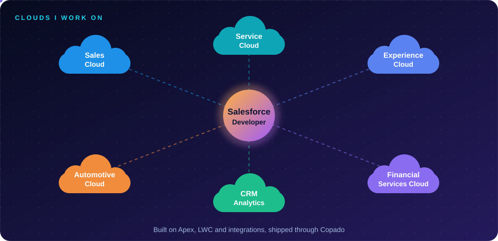
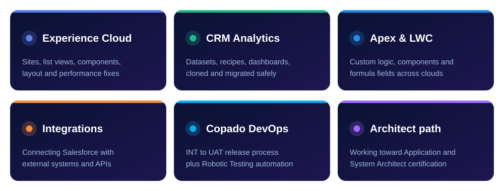
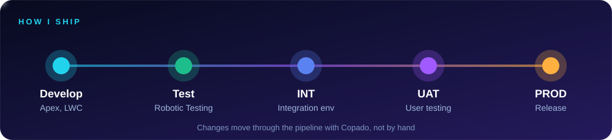
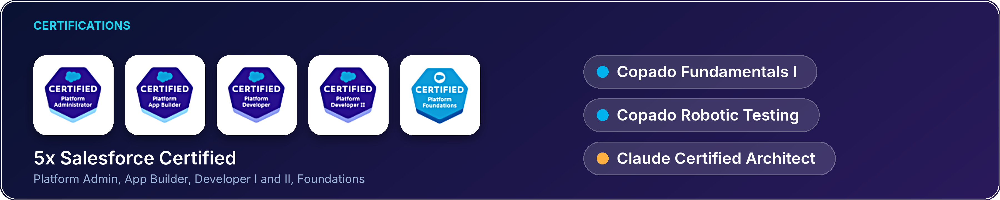

<div align="center">


<br>

**Sales** &nbsp;·&nbsp; **Service** &nbsp;·&nbsp; **Experience** &nbsp;·&nbsp; **Financial Services** &nbsp;·&nbsp; **Automotive** &nbsp;·&nbsp; **CRM Analytics**

<br>

[](https://www.linkedin.com/in/divya-chokshi-15472a245)
[](https://www.salesforce.com/trailblazer/dchokshi8)


</div>

## About me

I build and ship Salesforce solutions end to end: Experience Cloud sites that real users log into, CRM Analytics datasets and recipes that teams make decisions from, and custom logic that has to behave the same across multiple orgs.

I care about the unglamorous parts that make a release safe: metadata that matches between environments, deployments that don't overwrite the wrong thing, and fixes that hold up in UAT.

```apex
public with sharing class DivyaChokshi {

    public static void everyDay() {
        learn();
        build();
        review();
        deploy();   // through a pipeline, not by hand
    }

    public static String currentGoal() {
        return 'Salesforce Architect certification path';
    }
}
```

<div align="center">

</div>

## My Salesforce footprint

<div align="center">

</div>

<div align="center">

</div>

## What I work on

<div align="center">

</div>

<div align="center">

</div>

## How I ship

<div align="center">

</div>

<div align="center">

</div>

## Toolbox

<div align="center">


</div>

<div align="center">

</div>

## Credentials

<div align="center">

<br><br>
<a href="https://www.salesforce.com/trailblazer/dchokshi8"></a>
</div>

<details>
<summary><b>View certification dates</b></summary>

<br>

| Certification | Issued |
|---|---|
| Salesforce Certified Platform Administrator | Mar 2023 |
| Salesforce Certified Platform Foundations | Aug 2023 |
| Copado Fundamentals I | Oct 2023 |
| Copado Robotic Testing | Oct 2023 |
| Salesforce Certified Platform Developer | Mar 2024 |
| Salesforce Certified Platform App Builder | Dec 2024 |
| Salesforce Certified Platform Developer II | Sep 2026 |
| Claude Certified Architect | |

</details>

<div align="center">

</div>

## Let's connect

I'm always happy to talk about Experience Cloud, CRM Analytics, release management and the Architect path. The best place to reach me is [LinkedIn](https://www.linkedin.com/in/divya-chokshi-15472a245).

<div align="center">

</div>

<!--
OPTIONAL: live GitHub stats. Remove this comment wrapper once you have public repos with real activity.

<div align="center">


</div>
-->
