<div align="center">



<br>

**Experience Cloud** · **Financial Services Cloud** · **CRM Analytics** · **Apex & LWC** · **Integrations**

<br>

[](https://www.linkedin.com/in/divya-chokshi-15472a245)
[](https://www.salesforce.com/trailblazer/dchokshi8)

</div>

---

## About me

I build and ship Salesforce solutions end to end: Experience Cloud sites that real users log into, CRM Analytics datasets and recipes that teams make decisions from, and custom logic that has to behave the same across multiple orgs.

I care about the unglamorous parts that make a release safe: metadata that matches between environments, deployments that don't overwrite the wrong thing, and fixes that hold up in UAT.

```apex
public with sharing class DivyaChokshi {

    public static void everyDay() {
        learn();
        build();
        review();
        deploy();   // through a pipeline, not by hand
    }

    public static String currentGoal() {
        return 'Salesforce Architect certification path';
    }
}
```

## What I work on

| Area | What it looks like in practice |
|---|---|
| **Experience Cloud** | Site configuration, list views and components, layout and performance fixes |
| **CRM Analytics** | Datasets, recipes, apps and dashboards, including cloning and migrating them safely |
| **Apex & LWC** | Custom logic, components and formula fields across Sales, Service and Financial Services Cloud |
| **Integrations** | Connecting Salesforce with external systems |
| **DevOps and testing with Copado** | Promoting changes through INT and UAT with a release process, plus test automation with Copado Robotic Testing |

## Toolbox


## Credentials

| Certification | Issued |
|---|---|
| Salesforce Certified Platform Administrator | Mar 2023 |
| Salesforce Certified Platform Foundations | Aug 2023 |
| Salesforce Certified Platform Developer | Mar 2024 |
| Salesforce Certified Platform App Builder | Dec 2024 |
| Salesforce Certified Platform Developer II | Sep 2026 |
| Copado Fundamentals I | Oct 2023 |
| Copado Robotic Testing | Oct 2023 |
| Claude Certified Architect | |

<div align="center">
<a href="https://www.salesforce.com/trailblazer/dchokshi8"></a>
</div>

## Let's connect

I am always happy to talk about Experience Cloud, CRM Analytics, release management and the Architect path. The best place to reach me is [LinkedIn](https://www.linkedin.com/in/divya-chokshi-15472a245).

<!--
OPTIONAL: live GitHub stats. Your username is already filled in. Remove this comment wrapper.
They only look good once you have public repos with real activity.

<div align="center">


</div>
-->
